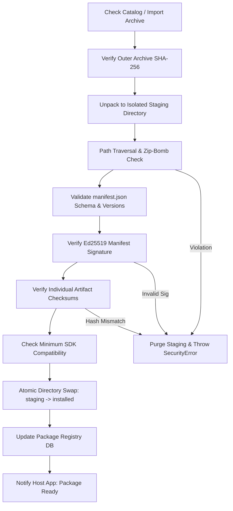

# Language Package Specification & Manifest Schema (v1)

This document defines the physical structure, metadata manifest schema, cryptographic verification, and lifecycle management for independently downloadable language packages in the SDK.

---

## 1. Design Principles

1. **Independent Lifecycle:** Each language package (`lang-sa`, `lang-ta`, `lang-hi`, `lang-te`) can be installed, updated, rolled back, or removed without reinstalling or restarting the core SDK.
2. **Offline-First:** Once installed, zero network access is ever required or attempted.
3. **Cryptographic Integrity & Authenticity:** Every package file is hashed with SHA-256, and package manifests are cryptographically signed with Ed25519 public keys.
4. **Atomic Operations:** Installations occur via a scratch staging directory and atomic directory swap to prevent corrupted states during app termination or battery death.
5. **Shared Asset Deduplication:** When multiple languages share a multilingual acoustic backbone or tokenizer, assets are reference-counted so uninstalling one language does not break another.

---

## 2. Directory Layout of an Installed Package

Within the host application's private app data storage directory (e.g. `/data/user/0/com.app/files/vaani/packages/lang-ta/`):

```text
lang-ta/
├── manifest.json              # Signed package metadata & checksums
├── manifest.sig               # Ed25519 digital signature
├── LICENSE                    # Applicable license for weights and data
├── NOTICE                     # Attribution and training provenance
├── model/
│   ├── acoustic_model.onnx    # Quantized INT8 / FP16 Conformer CTC graph
│   └── tokens.txt             # Model vocabulary (tokens, blank, special symbols)
├── phonetics/
│   ├── g2p_rules.json         # Brahmic grapheme-cluster and allophone rules
│   ├── phoneme_inventory.json # Canonical IPA inventory and articulatory metadata
│   └── lexicon_overrides.json # Irregular loanwords / classical pronunciation exceptions
└── feedback/
    └── strings_en.json        # Articulatory feedback strings (English)
    └── strings_ta.json        # Articulatory feedback strings (Tamil localized)
```

---

## 3. Package Manifest Schema (v1.0.0)

A JSON schema for `manifest.json`:

```json
{
  "$schema": "https://vaani.dev/schemas/package-manifest-v1.json",
  "schemaVersion": "1.0.0",
  "packageId": "lang-ta",
  "language": "ta-IN",
  "script": "Taml",
  "version": "1.0.0",
  "minSdkVersion": "0.1.0",
  "displayName": "Tamil (தமிழ்)",
  "publisher": {
    "name": "Vaani Core Team",
    "url": "https://github.com/nltsravi/vaani-core",
    "publicKeyId": "vaani-release-2026-01"
  },
  "capabilities": [
    "speechRecognition",
    "pronunciationAssessment",
    "phonemeFeedback",
    "wordFeedback",
    "characterMapping"
  ],
  "model": {
    "id": "indicconformer-ctc-ta-int8",
    "architecture": "Conformer-CTC",
    "quantization": "int8",
    "sampleRate": 16000,
    "featureDimension": 80,
    "provenance": "AI4Bharat Vistaar IndicConformer (Fine-tuned on Tamil)",
    "license": "MIT"
  },
  "artifacts": [
    {
      "path": "model/acoustic_model.onnx",
      "sizeBytes": 47185920,
      "sha256": "e3b0c44298fc1c149afbf4c8996fb92427ae41e4649b934ca495991b7852b855"
    },
    {
      "path": "model/tokens.txt",
      "sizeBytes": 16384,
      "sha256": "4b227777d4dd1fc61c6f884f48641d02b4d121d3fd328cb08b5531fcacdabf8a"
    },
    {
      "path": "phonetics/g2p_rules.json",
      "sizeBytes": 8192,
      "sha256": "ef2d127de37b942baad06145e54b0c619a1f22327b2ebbcfbec78f5564afe39d"
    },
    {
      "path": "phonetics/phoneme_inventory.json",
      "sizeBytes": 4096,
      "sha256": "01ba4719c80b6fe911b091a7c05124b64eeece964e09c058ef8f9805daca546b"
    }
  ],
  "totalSizeBytes": 47214592,
  "installedSizeBytes": 49283072,
  "knownLimitations": [
    "Casual colloquial contractions (e.g. 'போய்ட்டு வரேன்' vs 'போய்விட்டு வருகிறேன்') map to standard formal orthography.",
    "Very high ambient street noise (> 70 dB) reduces retroflex approximant ழ sensitivity."
  ]
}
```

---

## 4. Manifests for Initial Languages

### 4.1. Sanskrit (`lang-sa`)
* **Package ID:** `lang-sa`
* **Language Tag:** `sa-IN`
* **Script:** `Deva` (Devanagari)
* **Capabilities:** `["speechRecognition", "pronunciationAssessment", "phonemeFeedback", "characterMapping"]`
* **Model ID:** `indicconformer-ctc-sa-int8` (MIT License)
* **Status:** Verified. Complete Paninian G2P mapping with Visarga echo aspiration and vowel duration modeling.

### 4.2. Tamil (`lang-ta`)
* **Package ID:** `lang-ta`
* **Language Tag:** `ta-IN`
* **Script:** `Taml` (Tamil)
* **Capabilities:** `["speechRecognition", "pronunciationAssessment", "phonemeFeedback", "characterMapping"]`
* **Model ID:** `indicconformer-ctc-ta-int8` (MIT License)
* **Status:** Verified. High-fidelity liquid triplet (/l/, /ɭ/, /ɻ/) and rhotic (/ɾ/, /r/) contrast detection.

### 4.3. Hindi (`lang-hi`)
* **Package ID:** `lang-hi`
* **Language Tag:** `hi-IN`
* **Script:** `Deva` (Devanagari)
* **Capabilities:** `["speechRecognition", "pronunciationAssessment", "phonemeFeedback", "characterMapping"]`
* **Model ID:** `indicconformer-ctc-hi-int8` (MIT License)
* **Status:** Verified. Contextual schwa-deletion engine integrated with Devanagari Unicode normalizer.

### 4.4. Telugu (`te-IN`)
* **Package ID:** `lang-te`
* **Language Tag:** `te-IN`
* **Script:** `Telu` (Telugu)
* **Capabilities:** `["speechRecognition", "pronunciationAssessment", "phonemeFeedback", "characterMapping"]`
* **Model ID:** `indicconformer-ctc-te-int8` (MIT License)
* **Status:** Verified. Vowel length differentiation (e/ē, o/ō) and geminate consonant closure timing.

---

## 5. Secure Package Manager Lifecycle & Threat Prevention



### Safety Rules Enforced by Native Code:
1. **No Absolute Paths or `..`:** Archive entries containing `..` or root slashes `/` are immediately rejected (`ERR_PATH_TRAVERSAL`).
2. **Decompression Ratio Limit:** If uncompressed stream exceeds $10\times$ the declared archive size or $500\text{ MB}$, the extraction aborts (`ERR_ARCHIVE_BOMB`).
3. **Atomic Swap:** If an update fails verification, the previous working package remains intact. No partial writes touch the production directory.
4. **Active Session Lock:** If a language is currently loaded in an active inference session, uninstallation or update waits for session release or returns `ERR_RESOURCE_BUSY`.
